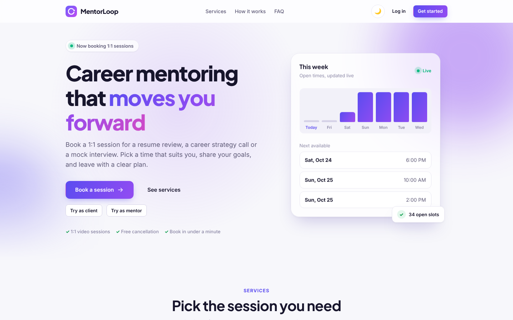
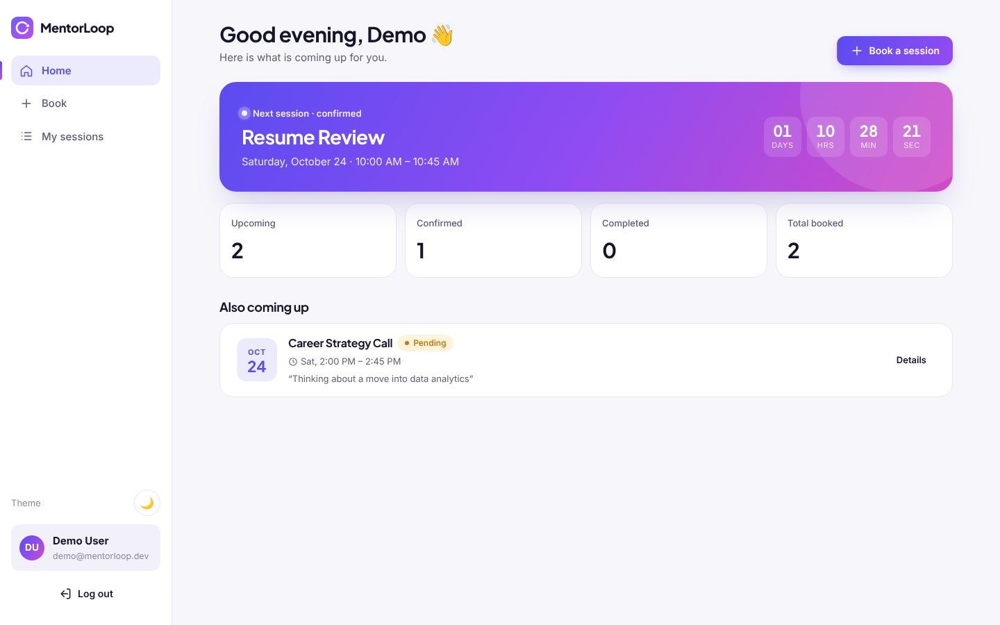
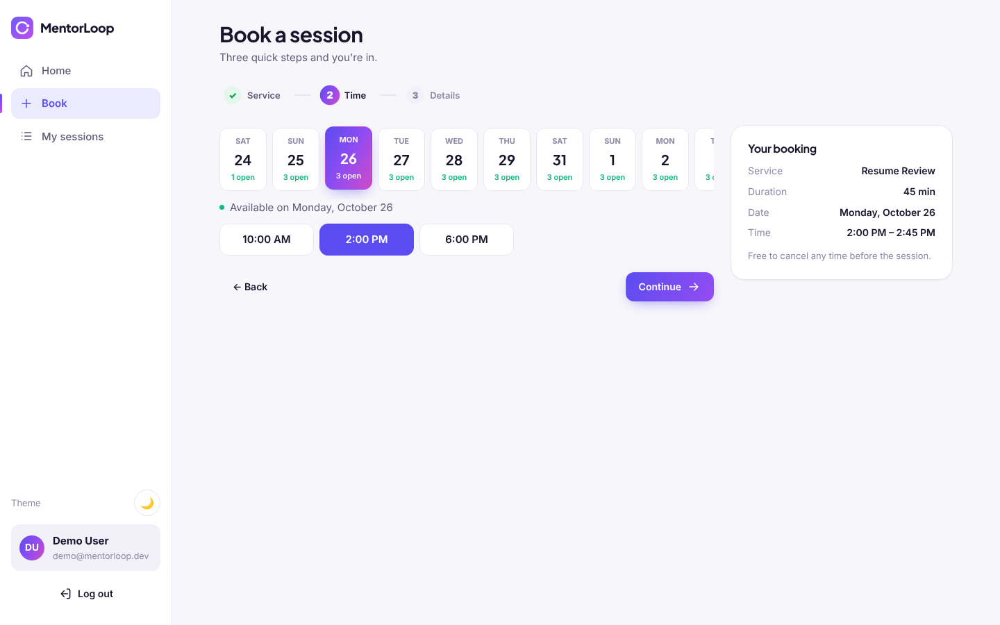
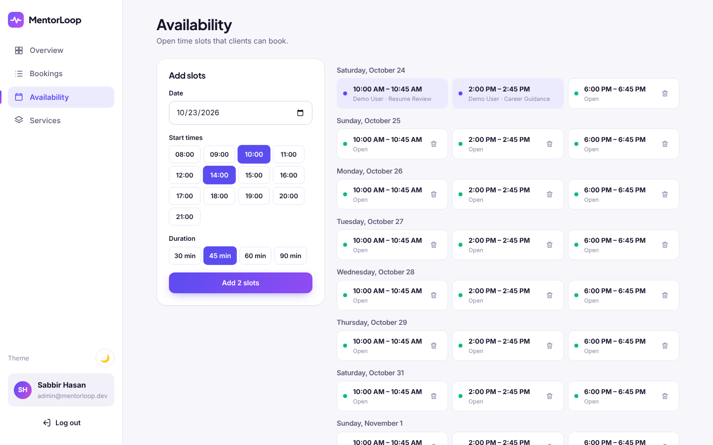
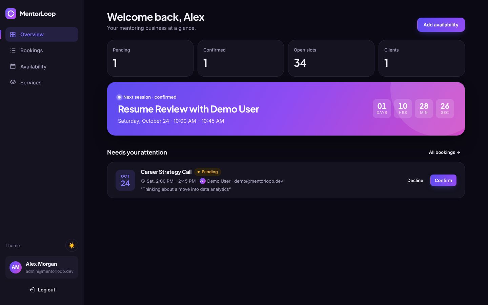

<h1 align="center">MentorLoop</h1>

<p align="center">
  <b>A job-search toolkit with human mentoring built in.</b> Candidates track every application, match their resume to each job with AI, prepare for interviews, keep momentum with weekly goals, and book a mentor when they need a human.
</p>

<p align="center">
  <a href="https://mentor-loop-five.vercel.app"><b>Live demo</b></a> · React 19 · TypeScript · Express 5 · PostgreSQL · Prisma · Claude API · Docker
</p>



## Features

- **Job tracker:** a Kanban board (drag and drop, or a stage select on touch and keyboard) and a searchable table. Each job has a timeline of stage changes, interview rounds, follow-ups and notes. Stats show the response rate, interviews, offers and which follow-ups are due.
- **AI coach** (Claude): upload a PDF or paste your resume and get an overall, ATS and **job match** score, prioritised fixes, before → after bullet rewrites, missing keywords and red flags. From a saved job it also writes **interview questions** (some about your own projects) and drafts an editable **cover letter** you can save to the job.
- **Weekly goals and streaks:** targets like "5 applications, 2 interviews", with progress computed from what you log, in your own timezone; a daily activity streak and a weekly "all goals met" streak.
- **Mentoring:** book a Resume Deep-Dive, Career Guidance Call or Mock Interview; attach an AI review so the mentor arrives prepared. The mentor confirms requests, publishes availability and manages services.
- **Demo mode** lets visitors try both sides with one click ("Try as client" / "Try as mentor").

Also: email + password or Google sign-in, **no double booking**, a responsive dashboard (sidebar on desktop, tab bar on mobile), and light/dark themes.

| Client dashboard                                   | Booking flow                                   |
| -------------------------------------------------- | ---------------------------------------------- |
|    |        |
| **Mentor availability**                            | **Dark mode**                                  |
|  |  |

## Tech stack

| Layer    | Tech                                                                      |
| -------- | ------------------------------------------------------------------------- |
| Frontend | React 19, TypeScript, Vite, React Router, TanStack Query, CSS Modules     |
| Backend  | Node.js, Express 5, TypeScript, zod validation, JWT in an httpOnly cookie |
| AI       | Anthropic TypeScript SDK, Claude Haiku 5.5, structured outputs (zod)      |
| Database | PostgreSQL, Prisma ORM (migrations + seed)                                |
| Tooling  | npm workspaces, ESLint, Prettier, Vitest + Supertest, GitHub Actions CI   |
| Hosting  | Vercel (web), Render (API, Docker), Neon (Postgres), all on free tiers    |

## Production setup

```
 Browser
    │  https://mentor-loop-five.vercel.app
    ▼
 Vercel ── serves the React build (static files)
    │  /api/*  rewritten (server-side proxy) to Render
    ▼
 Render ── Express API in a Docker container (apps/api/Dockerfile)
    │  DATABASE_URL (SSL)
    ▼
 Neon ──── serverless PostgreSQL
```

**Why the proxy:** the web app calls `/api` on its own origin. Vercel forwards those requests to Render (`apps/web/vercel.json`), so the browser sees one origin: the auth cookie stays first-party (`SameSite=Lax`) and no CORS setup is needed. Locally, the Vite dev proxy and nginx in Docker do the same job.

| Service    | What runs there                   | Config                                                                                       |
| ---------- | --------------------------------- | -------------------------------------------------------------------------------------------- |
| **Neon**   | PostgreSQL (Singapore)            | Use the **direct** connection string (not `-pooler`), with `?sslmode=require`                |
| **Render** | API, free web service (Singapore) | Docker, Dockerfile `./apps/api/Dockerfile`, build context `.`, health check `/api/health`    |
| **Vercel** | Web app                           | Root directory `apps/web`, Vite preset; `vercel.json` proxies `/api/*` and adds SPA fallback |

**Render environment variables**

| Variable                                        | Value                                         |
| ----------------------------------------------- | --------------------------------------------- |
| `DATABASE_URL`                                  | Neon direct connection string                 |
| `JWT_SECRET`                                    | Long random string (`openssl rand -hex 32`)   |
| `CLIENT_ORIGIN`                                 | `https://mentor-loop-five.vercel.app`         |
| `DEMO_MODE`                                     | `true` for the demo, `false` for real clients |
| `SEED_ON_START`                                 | `true` on the first deploy only, then `false` |
| `ADMIN_NAME` / `ADMIN_EMAIL` / `ADMIN_PASSWORD` | Mentor account created by the seed            |
| `GOOGLE_CLIENT_ID`                              | Optional; empty hides the Google button       |
| `ANTHROPIC_API_KEY`                             | Optional; empty turns the AI coach off        |
| `ANTHROPIC_MODEL`                               | Default `claude-haiku-5-5`                    |
| `AI_DAILY_LIMIT`                                | AI requests per user per 24 h (default `10`)  |

On start, the container runs `prisma migrate deploy`, then the seed if `SEED_ON_START=true`, then the server.

**Deploys:** pushing to `main` redeploys both Render and Vercel automatically.

**Free-tier limits:** the Render API sleeps after 15 minutes idle (first request then takes about 30–60 s). A cron-job.org ping to `/api/health` every 10 minutes keeps it awake.

## Run locally

**Docker (everything in one command):**

```bash
cp .env.example .env        # optional: defaults work for a local demo
docker compose up --build   # http://localhost:8080
```

**Dev mode:** needs Node 20+ and PostgreSQL (or `docker compose up db`).

```bash
npm install
cp apps/api/.env.example apps/api/.env
npm run db:generate && npm run db:migrate && npm run db:seed
npm run dev                 # API on :4000, web on :5173 (proxies /api)
```

Demo accounts (local seed): mentor `admin@mentorloop.dev` / `admin12345`, client `demo@mentorloop.dev` / `demo12345`.

`npm test` (API tests, needs a `mentorloop_test` DB) · `npm run lint` · `npm run typecheck` · `npm run build`

## Code structure

```
apps/api/   Express API: src/modules/{auth,services,slots,bookings,jobs,ai,goals} → routes → service → Prisma
            prisma/ (schema, migrations, seed), tests/ (Vitest + Supertest on real Postgres)
apps/web/   React app: src/{api,auth,components,layouts,pages,styles}
```

Key decisions:

- **No double booking:** `UPDATE slot SET status='booked' WHERE id=$1 AND status='open'` in a transaction. Only one request wins; the other gets `409`.
- **One error shape:** `{ error: { code, message, fields? } }`; forms map `fields` to inline messages.
- **Validated env:** `src/config/env.ts` checks env vars with zod and fails fast on boot.
- **One table for every AI feature:** `AiRun` gives one quota, one background runner and one polling endpoint. `POST` returns `202` at once and the web app polls `GET /api/ai/runs/:id`, so a long model call never hits the hosting proxy's timeout.
- **AI safety:** resumes and job posts are passed as labelled, untrusted data; output is schema-checked and scores clamped; refusals and API errors become a failed run with a user-safe message. PDFs are checked (type, `%PDF` bytes, 5 MB), kept in memory and never stored. The structured profile from a review feeds cover letters and interview prep.
- **Goals computed, not counted:** weekly progress and streaks are derived from jobs, timeline events and AI runs in the user's timezone, so no counter can drift.

## Google sign-in (optional)

Google Cloud Console → Credentials → **OAuth client ID** (Web). Add the site URL (e.g. `https://mentor-loop-five.vercel.app`) to **Authorized JavaScript origins**, then set `GOOGLE_CLIENT_ID` on Render.

## AI coach (optional)

Create an API key in the [Claude Console](https://platform.claude.com) and set `ANTHROPIC_API_KEY` (in `apps/api/.env` locally, or on Render). Each review, question set or cover letter is one Claude Haiku 5.5 call. `AI_DAILY_LIMIT` caps calls per user per day (the mentor account is exempt). With no key, the AI buttons are hidden and the endpoints return `503`. An `ANTHROPIC_API_KEY` exported in your shell (for example from `~/.zshrc`) overrides `apps/api/.env`; if reviews fail with "isn't set up correctly", the API log says which setting Anthropic rejected.

## Roadmap

Career tracks (Software, AI and QA engineer: fresher → advanced) · curated video library · CSV export of the job tracker · email follow-up reminders · paid sessions (Stripe) · calendar invites and meeting links
