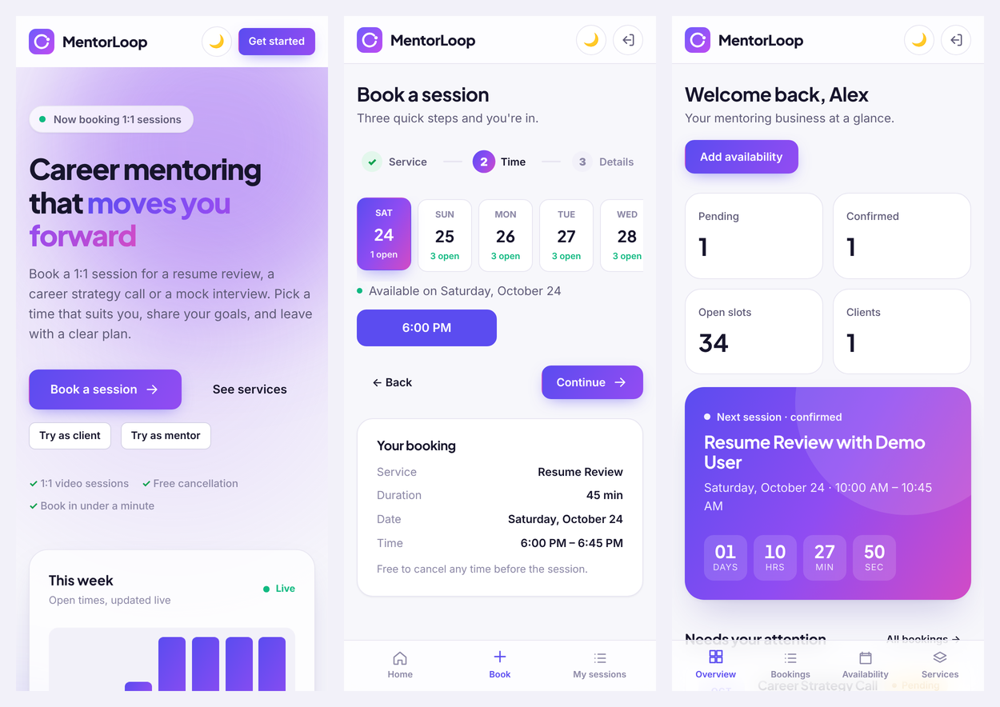

<h1 align="center">MentorLoop</h1>

<p align="center">
  <b>1:1 mentoring and booking SaaS</b>. Clients book resume reviews, career strategy calls and mock interviews; the mentor manages services, availability and bookings from a clean dashboard.
</p>

<p align="center">
  React 19 · TypeScript · Node.js (Express 5) · PostgreSQL · Prisma · Docker
</p>


## Highlights

- **Two login options:** email + password, or **Continue with Google** (same account, linked by verified email).
- **Booking in 3 steps** (service → time → details) with **no double booking**, even when two people click the same slot at the same moment.
- **Mentor dashboard:** live countdown to the next session, pending requests with one-click confirm/decline, availability planner and service editor.
- **Responsive:** sidebar on desktop, bottom tab bar on phone and tablet, bottom-sheet dialogs on mobile.
- **Polished UI:** light/dark theme, live weekly-availability chart, pulsing "live" indicators, cursor-following glow, tilt cards, skeleton loaders, toasts. Respects `prefers-reduced-motion`.
- **Demo mode:** "Try as client" / "Try as mentor" buttons log visitors straight into seeded accounts.

| Client dashboard                                   | Booking flow                                   |
| -------------------------------------------------- | ---------------------------------------------- |
|    |        |
| **Mentor availability**                            | **Dark mode**                                  |
|  |  |



## Quick start (Docker)

```bash
cp .env.example .env        # optional: defaults work for a local demo
docker compose up --build
```

Open **http://localhost:8080** and click **Try as client** or **Try as mentor**.

| Account     | Email                  | Password     |
| ----------- | ---------------------- | ------------ |
| Mentor      | `admin@mentorloop.dev` | `admin12345` |
| Demo client | `demo@mentorloop.dev`  | `demo12345`  |

On start, the API container runs migrations and an idempotent seed (3 services, 14 days of slots, sample bookings).

## Local development

Requirements: Node 20+ and PostgreSQL 16 (or just `docker compose up db`).

```bash
npm install
cp apps/api/.env.example apps/api/.env
npm run db:generate
npm run db:migrate          # creates tables
npm run db:seed             # demo data
npm run dev                 # API on :4000, web on :5173 (proxies /api)
```

| Command             | What it does                                         |
| ------------------- | ---------------------------------------------------- |
| `npm test`          | API integration tests (needs a `mentorloop_test` DB) |
| `npm run lint`      | ESLint across both apps                              |
| `npm run typecheck` | TypeScript, both apps                                |
| `npm run build`     | Production builds                                    |

## Architecture

```
apps/
  api/                    Express + TypeScript
    src/
      config/env.ts       env vars validated with zod (fails fast on boot)
      lib/                prisma client, AppError helpers, JWT
      middleware/         requireAuth / requireAdmin, validateBody(zod), error handler
      modules/            one folder per feature: routes → service → prisma
        auth/  services/  slots/  bookings/
    prisma/               schema, migrations, seed
    tests/                vitest + supertest against a real Postgres
  web/                    React + Vite + TypeScript
    src/
      api/                typed fetch client, one file per backend module
      auth/               AuthContext, Google button, route guard, demo buttons
      components/         Button, Modal, Toast, BookingCard, PulseDot, CursorGlow …
      layouts/            public site layout, app shell (sidebar / tab bar)
      pages/              Landing, Auth, user/*, admin/*
      styles/             design tokens (light + dark) and base styles
```

**Key decisions**

- **Feature modules:** each backend feature is three files (`*.routes.ts`, `*.service.ts`, `*.schema.ts`). Routes stay thin, business rules live in services, and input is validated at the edge with zod.
- **Session cookie, not localStorage:** a JWT in an `httpOnly`, `SameSite=Lax` cookie, `Secure` over HTTPS. The web app calls `/api` on the same origin (Vite proxy in dev, nginx in Docker), so no CORS or token handling in the browser.
- **Double-booking guard:** `UPDATE slot SET status='booked' WHERE id=$1 AND status='open'` inside a transaction. Only one request can win; the loser gets `409` and the UI sends them back to pick another time. Covered by a parallel-request test.
- **One error shape:** every error is `{ error: { code, message, fields? } }`; forms map `fields` to inline messages.
- **Server state** with TanStack Query (caching, refetch after mutations). No global store needed.
- **Plain CSS** (tokens + CSS Modules), with no UI kit to fight when customising for a client.

### API

| Method & path                      | Access | Purpose                                 |
| ---------------------------------- | ------ | --------------------------------------- |
| `POST /api/auth/signup`, `/login`  | public | Email + password (rate limited)         |
| `POST /api/auth/google`            | public | Google ID token → session               |
| `POST /api/auth/demo`              | public | Demo login (only when `DEMO_MODE=true`) |
| `GET /api/auth/me`, `POST /logout` | any    | Current user / end session              |
| `GET /api/services`, `/slots`      | public | Active services, open future slots      |
| `POST /api/bookings`               | user   | Book a slot                             |
| `GET /api/bookings/mine`           | user   | Own bookings                            |
| `POST /api/bookings/:id/cancel`    | owner  | Cancel and reopen the slot              |
| `GET /api/bookings`, `/stats`      | admin  | All bookings, dashboard numbers         |
| `PATCH /api/bookings/:id/status`   | admin  | confirm → complete, or cancel           |
| `POST/PATCH /api/services`         | admin  | Manage services                         |
| `POST/DELETE /api/slots`           | admin  | Manage availability (overlaps rejected) |

## Google sign-in

1. Google Cloud Console → APIs & Services → Credentials → **Create OAuth client ID** (Web application).
2. Add your site to **Authorized JavaScript origins** (e.g. `http://localhost:8080`, `https://your-domain.com`).
3. Put the client ID in `GOOGLE_CLIENT_ID` (`.env` for Docker, `apps/api/.env` for local dev).

Without it the Google button simply hides itself.

## Running it for real

Set these in `.env` before deploying:

- `DEMO_MODE=false`: removes the demo buttons and endpoint.
- `JWT_SECRET`: a long random string (`openssl rand -base64 48`).
- `ADMIN_NAME` / `ADMIN_EMAIL` / `ADMIN_PASSWORD`: your mentor account, created on first start.
- `POSTGRES_PASSWORD`: a strong value.
- Serve over **HTTPS** (e.g. Caddy or a cloud load balancer in front of the `web` container).

## Adding a feature (e.g. learning resources / YouTube videos)

1. Add a `Resource` model to `prisma/schema.prisma` and run `npm run db:migrate`.
2. Create `apps/api/src/modules/resources/` with `resources.routes.ts`, `.service.ts` and `.schema.ts`, then mount it in `app.ts`.
3. Add `apps/web/src/api/resources.ts`, a page under `pages/`, a route in `App.tsx` and a nav item in `AppLayout.tsx`.

No existing module needs to change.

## Roadmap

- Learning resources (guideline videos, YouTube links)
- Paid sessions and courses (Stripe Checkout)
- Email notifications and calendar invites (.ics)
- Meeting links on confirmed bookings
